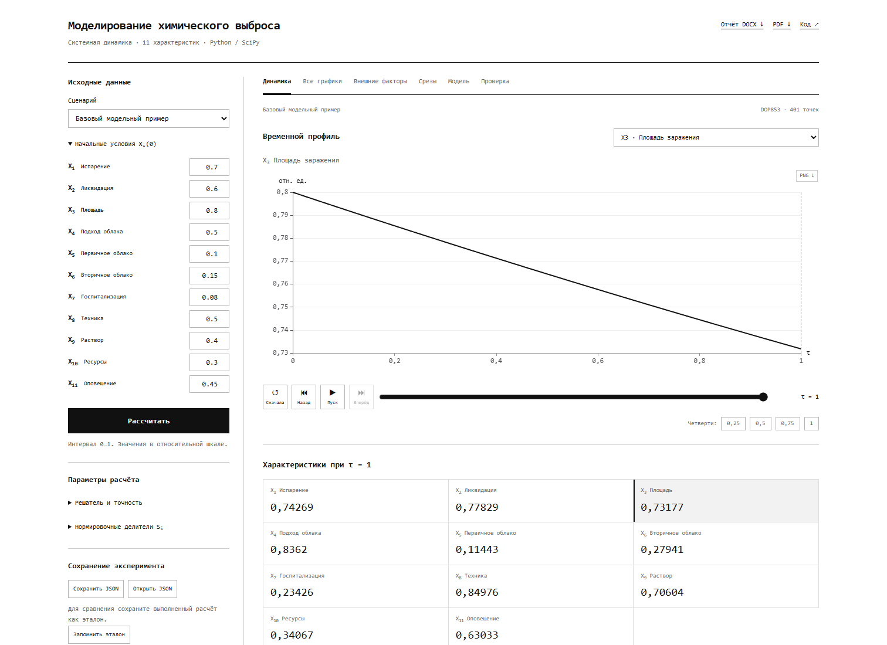

# Химический выброс

Лаборатория системной динамики для практической работы «Моделирование последствий выброса химически опасных веществ на промышленном объекте».

**Работающая модель, не заранее записанная анимация.** Python/SciPy решает систему из 11 нелинейных ОДУ. Интерфейс позволяет менять все начальные условия, обе алгебраические части каждого уравнения и семь временных внешних факторов. Результаты доступны в виде интерактивных временных графиков, четырёх лепестковых срезов, таблиц и файлов CSV/JSON/PNG.



## Запуск на Windows

Проверенная версия Python – 3.12. Для первой сборки из Git нужен Node.js 24 (поддерживается также 22.12+).

1. Клонировать репозиторий и перейти в каталог проекта.
2. Запустить `start.cmd` или `powershell -ExecutionPolicy Bypass -File start.ps1`.
3. Открыть **http://127.0.0.1:8000**.

Сценарий установит зависимости в `.venv`, при необходимости соберёт интерфейс и запустит сервер. При работе из подготовленного архива сборка интерфейса уже включена; Node.js тогда не нужен. Интернет требуется для первой установки пакетов, но не для последующих вычислений и графиков. Остановка сервера: Ctrl+C.

### Ручной запуск и Linux/macOS

```sh
python3.12 -m venv .venv
source .venv/bin/activate
pip install -r requirements.txt
npm --prefix frontend ci
npm --prefix frontend run build
python -m uvicorn backend.app:app --host 127.0.0.1 --port 8000
```

На Windows вместо `source` используется `.venv\Scripts\Activate.ps1`. Существует также Dockerfile:

```sh
docker build -t chemical-release .
docker run --rm -p 127.0.0.1:8000:8000 chemical-release
```

Контейнерная инструкция предоставлена, но сборка Docker не входит в локально выполненные проверки, если это явно не отмечено в протоколе. Не публикуйте исследовательский сервер без дополнительной защиты и ограничений ресурсов.

## Что реализовано

- Ввод 11 начальных условий и положительных делителей скоростей S.
- Полный редактор 22 выражений f⁺ и f⁻ и семи внешних F(t).
- SciPy `solve_ivp`: DOP853, RK45 и Radau с контролем ошибок и диагностикой.
- Все 11 временных графиков, курсор, воспроизведение, пауза, отдельный шаг и переход к четвертям.
- Срезы в 0,25 / 0,50 / 0,75 / 1,00 и четыре лепестковых состояния с общими масштабами.
- Сравнение с зафиксированным эталонным сценарием; пунктирные временные профили и численная разность.
- Граф зависимостей, полученный из реально исполняемых выражений.
- Импорт конфигурации и экспорт результатов CSV/JSON; сохранение любого графика в PNG.
- Встроенная численная верификация на трёх методах и двух аналитических эталонах.
- Явные ошибки области определения и предупреждения о недопустимой интерпретации; нет скрытого обрезания траекторий.

## Важная граница применимости

Это **агрегированная учебная модель из задания**, не модель рассеивания газа. Она не вычисляет поле концентраций, дозу, границы безопасной зоны и реальные потери. Готовые сценарии заданы в относительной шкале: исходные значения и S являются условиями эксперимента, а не данными реального предприятия. Число X6 = 0.2794 не означает 0.2794 человека.

В задании есть несогласованность: текст и таблица функций определяют 11 характеристик, а изображение системы (4) содержит 13 и другие зависимости. Реализована **полная табличная редакция X1…X11**. Отсутствующие табличные вторые части равны нулю. Все числовые коэффициенты перенесены с исходными знаками.

Принятая система:

```text
dXi/dt = (plus_i(X,F,t) - minus_i(X,F,t)) / S_i
```

В исходной таблице несколько `minus_i` отрицательны и поэтому при вычитании увеличивают производную. Это не исправляется молча. В приложении одна табличная модель, без переключения знаков и вычитания модулей. Подробности и все формулы приведены в отчёте и [описании модели](docs/MODEL.md).

Заявленную в задании эмпирическую погрешность 13% программа **не присваивает себе**: исходных наблюдений нет. Верификация алгоритма и валидация по данным аварии – разные задачи.

## Работа с выражениями

В правых частях разрешены `X1`…`X11`, `F1`…`F7`, `t`, `pi`, `e`, операции `+ - * / **`, функции `sqrt`, `exp`, `log`, `sin`, `cos`, `tanh`, `abs`, `min`, `max`. Формулы факторов используют только `t` и константы. Десятичная точка обязательна; степень – `**`.

Например: `0.052*sqrt(X3*F6)` или `0.8*(1+0.5*t)`.

Это ограниченный интерпретатор AST, **не eval**. Импорты, атрибуты, лямбды, индексация и произвольный код не исполняются. Формулы ограничены по длине/сложности; контролируются область определения и конечность результата. Проверки не превращают неверную научную модель в корректную.

После изменения параметров нажмите «Рассчитать». До пересчёта графики явно помечаются как результаты предыдущей конфигурации. Экспорт результата всегда содержит использованную при вычислении конфигурацию, а не несохранённую форму.

## Проверки и воспроизводимость

```sh
pip install -r requirements-dev.txt
python -m pytest -q --junitxml=report/evidence/pytest.xml
npm --prefix frontend run build
python scripts/reproduce.py
```

Сохранены фактические протоколы:

- [Тесты Python и API](report/evidence/pytest.xml): 52 успешных случая.
- [Браузерные проверки](report/evidence/browser-checks.json): 34 проверки, без необработанных ошибок JavaScript.
- [Независимые численные проверки](report/evidence/verification.json): сравнение с более строгими допусками **и в 10 раз меньшим максимальным шагом**, RK45/Radau, экспоненциальный эталон и связанная система против матричной экспоненты.
- [Сводка четырёх экспериментов](report/evidence/summary.json), [исходные траектории](report/evidence/experiments.json), [базовая таблица CSV](report/evidence/baseline.csv).

У каждого результата есть SHA-256 конфигурации. Он идентифицирует входные данные и настройки; версию кода проверяйте по Git-коммиту. Длительность расчёта зависит от машины и не обязана повторяться побитно.

Браузерная проверка при запущенном сервере:

```sh
npx --prefix frontend playwright install chromium
node scripts/qa_browser.mjs
```

Можно указать установленный Chrome переменной `CHROME_PATH`. Для среды с общим Playwright-модулем предусмотрена `PLAYWRIGHT_MODULE`. Эти переменные не нужны обычному пользователю приложения.

## Отчёт

Готовый DOCX находится в `report/`. В нём представлены теория, все 11 уравнений, 13 рисунков, 8 содержательных таблиц, 17 нумерованных формул, реальные скриншоты и рассчитанные эксперименты. Числа подставляются из результатов рабочего Python-ядра; графики создаются `scripts/reproduce.py`. Исходник сборки: `report/build_report.py`, математические структуры OMML: `report/math_ooxml.py`.

Для повторной сборки DOCX требуется `python-docx`, `lxml` и исходный оформительский образец, передаваемый `--template`. Образец не распространяется в репозитории. На Windows обновление оглавления и PDF-экспорт выполняются установленным Word через `report/export_word.ps1`; исходный образец не изменяется.

## Источники и заимствования

Модель: предоставленное учебное задание, таблица 1, с. 6; научный контекст – Цвиркун А.Д., Резчиков А.Ф., Кушелева Е.В., Кушникова Е.В., «Моделирование последствий выбросов химически опасных веществ в атмосферу на основе аппарата системной динамики», *Вестник компьютерных и информационных технологий*, 2019, № 3, с. 40–47 ([ИПУ РАН](https://www.ipu.rssi.ru/node/52144)).

Численные методы: [SciPy solve_ivp](https://docs.scipy.org/doc/scipy/reference/generated/scipy.integrate.solve_ivp.html), [DOP853 и Radau у авторов методов](https://www.unige.ch/~hairer/software.html), [Virtanen et al., Nature Methods, 2020](https://doi.org/10.1038/s41592-019-0686-2).

Ориентиром для минималистичного чёрно-белого интерфейса и состава результата послужил [rogue-wave-calc](https://github.com/greygn/rogue-wave-calc). Его вычислительное ядро, графика и исходный код не копировались. Оформительский ориентир отчёта – предоставленный [пример практической работы](https://docs.google.com/document/d/1ghoHClS0FpzLUlGxLp4xZCyVmfpr1rr4/edit).

GitHub Pages не запускает Python backend. Репозиторий – публикация исходников и воспроизводимого проекта, а не обещание статического хостинга полного приложения.
