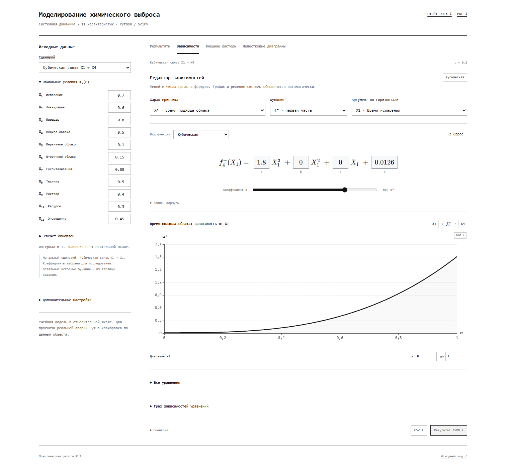

# Химический выброс

[Открыть приложение без установки](https://snailrake.github.io/practwo/)

Онлайн-версия запускает тот же Python-код и SciPy прямо в браузере через
Pyodide / WebAssembly. Сервер для расчётов и установка Python пользователю
не нужны. При первом запуске загружается около 32 МБ среды и библиотек;
скорость загрузки зависит от подключения. Все файлы раздаются самим сайтом,
а введённые параметры не отправляются на вычислительный сервер.

Лаборатория системной динамики для практической работы «Моделирование последствий выброса химически опасных веществ на промышленном объекте».

**Работающая модель, не заранее записанная анимация.** Python/SciPy решает систему из 11 нелинейных ОДУ. Интерфейс позволяет менять все начальные условия, обе алгебраические части каждого уравнения и семь временных внешних факторов. Результаты доступны в виде интерактивных временных графиков, четырёх лепестковых срезов, таблиц и файлов CSV/JSON/PNG.



## Запуск на Windows

Проверенная версия Python – 3.12. Для первой сборки из Git нужен Node.js 24 (поддерживается также 22.12+).

1. Клонировать репозиторий и перейти в каталог проекта.
2. Запустить `start.cmd` или `powershell -ExecutionPolicy Bypass -File start.ps1`.
3. Открыть **http://127.0.0.1:8000**.

Сценарий установит зависимости в `.venv`, при необходимости соберёт интерфейс и запустит сервер. При работе из подготовленного архива сборка интерфейса уже включена; Node.js тогда не нужен. Интернет требуется для первой установки пакетов, но не для последующих вычислений и графиков. Остановка сервера: Ctrl+C.

### Ручной запуск и Linux/macOS

```sh
python3.12 -m venv .venv
source .venv/bin/activate
pip install -r requirements.txt
npm --prefix frontend ci
npm --prefix frontend run build
python -m uvicorn backend.app:app --host 127.0.0.1 --port 8000
```

На Windows вместо `source` используется `.venv\Scripts\Activate.ps1`. Существует также Dockerfile:

```sh
docker build -t chemical-release .
docker run --rm -p 127.0.0.1:8000:8000 chemical-release
```

Контейнерная инструкция предоставлена, но сборка Docker не входит в локально выполненные проверки, если это явно не отмечено в протоколе. Не публикуйте исследовательский сервер без дополнительной защиты и ограничений ресурсов.

## Что реализовано

- Ввод 11 начальных условий и положительных делителей скоростей S.
- Редактор 22 частей уравнений и семи внешних факторов. Обе части выбранного уравнения видны вместе, числа вводятся внутри математической записи.
- На одном экране показаны график выбранной части и результат по времени. Пересчёт автоматический, одна кнопка восстанавливает уравнение или фактор текущего сценария.
- SciPy `solve_ivp`: DOP853, RK45 и Radau с контролем ошибок и диагностикой.
- Все 11 временных графиков, просмотр одного или всех сразу, ползунок времени и переход к четвертям.
- Срезы в 0,25 / 0,50 / 0,75 / 1,00 и четыре лепестковых состояния с общими масштабами.
- Сравнение с зафиксированным эталонным сценарием; пунктирные временные профили и численная разность.
- Граф зависимостей, полученный из реально исполняемых выражений.
- Импорт конфигурации и экспорт результатов CSV/JSON; сохранение любого графика в PNG.
- Встроенная численная верификация на трёх методах и двух аналитических эталонах.
- Явные ошибки области определения и предупреждения о недопустимой интерпретации; нет скрытого обрезания траекторий.

## Важная граница применимости

Это **агрегированная учебная модель из задания**, не модель рассеивания газа. Она не вычисляет поле концентраций, дозу, границы безопасной зоны и реальные потери. Готовые сценарии заданы в относительной шкале: исходные значения и S являются условиями эксперимента, а не данными реального предприятия. Число X6 = 0.2794 не означает 0.2794 человека.

В задании есть несогласованность: текст и таблица функций определяют 11 характеристик, а изображение системы (4) содержит 13 и другие зависимости. Реализована **полная табличная редакция X1…X11**. Отсутствующие табличные вторые части равны нулю. Все числовые коэффициенты перенесены с исходными знаками.

Принятая система:

```text
dXi/dt = (plus_i(X,F,t) - minus_i(X,F,t)) / S_i
```

В исходной таблице несколько `minus_i` отрицательны и поэтому при вычитании увеличивают производную. Это не исправляется молча. В приложении одна табличная модель, без переключения знаков и вычитания модулей. Подробности и все формулы приведены в отчёте и [описании модели](docs/MODEL.md).

Заявленную в задании эмпирическую погрешность 13% программа **не присваивает себе**: исходных наблюдений нет. Верификация алгоритма и валидация по данным аварии – разные задачи.

## Работа с выражениями

В правых частях разрешены `X1`…`X11`, `F1`…`F7`, `t`, `pi`, `e`, операции `+ - * / **`, функции `sqrt`, `exp`, `log`, `sin`, `cos`, `tanh`, `abs`, `min`, `max`. Формулы факторов используют только `t` и константы. Десятичная точка обязательна; степень – `**`.

Например: `0.052*sqrt(X3*F6)` или `0.8*(1+0.5*t)`.

Это ограниченный интерпретатор AST, **не eval**. Импорты, атрибуты, лямбды, индексация и произвольный код не исполняются. Формулы ограничены по длине/сложности; контролируются область определения и конечность результата. Проверки не превращают неверную научную модель в корректную.

После изменения параметров система пересчитывается автоматически через 400 мс
после последнего ввода. Кривая полинома реагирует сразу. Пока расчёт не завершён,
результаты помечены как предыдущие, а экспорт отключён. Запоздавшие ответы и
ошибки старых запросов не подменяют актуальный результат. Недописанный коэффициент,
например `-`, приостанавливает пересчёт до завершения ввода.

### Показ зависимости на защите

1. Сайт открывает сценарий «Кубические зависимости». Во всех 17 ненулевых
   частях уравнений кубическая форма относится к одному из исходных аргументов.
   Остальные аргументы взяты в начальный момент при подборе коэффициентов.
   Сначала показана первая часть. Переключатель над формулой открывает
   вычитаемую часть. Делитель Sᵢ указан под формулой.
2. Измените число перед X₁³ на 0,9. Слева сразу меняется кривая выбранной
   части, справа после автоматического пересчёта обновляется X₄ по времени.
3. Четыре поля нужны кубическому полиному. Квадратичному соответствуют три,
   линейному – два, постоянной – одно. Вид выбирается под уравнением.
   Подпись графика показывает фактическую степень по введённым числам.
   В редакторе факторов по умолчанию показаны четыре поля Fⱼ(t).
4. Ползунок регулирует число, выбранное щелчком внутри формулы.
   Для остальных аналитических выражений их коэффициенты и показатели степеней
   также редактируются на своих местах, в том числе в дробях и под корнем.
5. Кнопка «Сброс» возвращает обе части выбранного уравнения или один внешний
   фактор к состоянию **текущего сценария**. После импорта исходной становится
   загруженная конфигурация.
6. Исходная таблица доступна в базовом сценарии. «Все результаты» открывает
   11 линий на общей оси времени, а «Лепестковые диаграммы» – четыре снимка
   с точными числами и общими редактируемыми пределами шкал.

Для каждой ненулевой части вычисляем табличное значение `f0` при начальных
условиях. Выбираем аргумент `u` и его табличную степень `p`, затем полагаем
`z = u/u0`, где `u0` – начальное значение аргумента. При положительной
степени используем `f0 * (2*z**3 + (p-5)*z**2 + (4-p)*z)`. Для обратного
множителя используем `f0 * (4-6*z+4*z**2-z**3)`. Значение и наклон по
выбранному аргументу совпадают с табличными в начальной точке с учётом
округления. Пять исходных нулевых частей заданы числом 0. Внешние факторы
задаются полиномами времени, начальное значение равно постоянному члену.
Коэффициенты и пределы шкал относятся к учебному примеру в относительных единицах.
Документы в каталоге `report` описывают предыдущий выпуск интерфейса.

«Базовый модельный пример · таблица задания» открывает исходную систему.
Её используют четыре эксперимента отчёта. Графики многомерных функций показывают сечение
по выбранному аргументу при остальных значениях начального состояния. Эти
фиксированные значения доступны под графиком. Переключение многомерной функции
на полином задаёт **новую функцию целиком**, без скрытой аппроксимации
или суммирования отдельных связей. Точки, в которых исходное выражение не
определено, показаны разрывами.

## Проверки и воспроизводимость

```sh
pip install -r requirements-dev.txt
python -m pytest -q --junitxml=report/evidence/pytest.xml
npm --prefix frontend run build
python scripts/reproduce.py
```

В интерфейсе четыре раздела – «Все результаты», «Зависимости», «Внешние факторы» и
«Лепестковые диаграммы». Выбор решателя и точности свёрнут в дополнительных
настройках; проверка расчёта и сравнение экспериментов раскрываются в результатах.
Сохранение и загрузка сценария доступны рядом с экспортом.

Протоколы, использованные при подготовке отчёта:

- [Тесты Python и API](report/evidence/pytest.xml): 83 успешных случая.
- [Браузерные проверки](report/evidence/browser-checks.json): 37 проверок, без необработанных ошибок JavaScript.
- [Проверки статической версии](report/evidence/pages/checks.json): 34 проверки, включая совпадение полных траекторий четырёх сценариев с локальным Python, независимый аналитический пример и пять встроенных численных критериев. Максимальное масштабированное расхождение в сохранённом прогоне – около 1.86e-16 при пороге 1e-9.
- [Независимые численные проверки](report/evidence/verification.json): сравнение с более строгими допусками **и в 10 раз меньшим максимальным шагом**, RK45/Radau, экспоненциальный эталон и связанная система против матричной экспоненты.
- [Сводка четырёх экспериментов](report/evidence/summary.json), [исходные траектории](report/evidence/experiments.json), [базовая таблица CSV](report/evidence/baseline.csv).

Текущая версия содержит 83 проверки Python/API. Дополнительный браузерный прогон
`scripts/qa_editor.mjs` проверяет все 29 редактируемых функций, коэффициенты,
ползунки, автоматический пересчёт и задержанные ответы. Он запускается вместе
с общими проверками локального интерфейса и Pages. Актуальные протоколы и скриншоты сохраняются в артефактах
[GitHub Actions](https://github.com/snailrake/practwo/actions).

У каждого результата есть SHA-256 конфигурации. Он идентифицирует входные данные и настройки; версию кода проверяйте по Git-коммиту. Длительность расчёта зависит от машины и не обязана повторяться побитно.

Браузерная проверка при запущенном сервере:

```sh
npx --prefix frontend playwright install chromium
node scripts/qa_browser.mjs
```

Можно указать установленный Chrome переменной `CHROME_PATH`. Для среды с общим Playwright-модулем предусмотрена `PLAYWRIGHT_MODULE`. Эти переменные не нужны обычному пользователю приложения.

## Отчёт

Готовый DOCX находится в `report/`. В нём представлены теория, все 11 уравнений, 13 рисунков, 8 содержательных таблиц, 17 нумерованных формул, реальные скриншоты и рассчитанные эксперименты. Числа подставляются из результатов рабочего Python-ядра; графики создаются `scripts/reproduce.py`. Исходник сборки: `report/build_report.py`, математические структуры OMML: `report/math_ooxml.py`.

Для повторной сборки DOCX требуется `python-docx`, `lxml` и исходный оформительский образец, передаваемый `--template`. Образец не распространяется в репозитории. На Windows обновление оглавления и PDF-экспорт выполняются установленным Word через `report/export_word.ps1`; исходный образец не изменяется.

## Источники и заимствования

Модель: предоставленное учебное задание, таблица 1, с. 6; научный контекст – Цвиркун А.Д., Резчиков А.Ф., Кушелева Е.В., Кушникова Е.В., «Моделирование последствий выбросов химически опасных веществ в атмосферу на основе аппарата системной динамики», *Вестник компьютерных и информационных технологий*, 2019, № 3, с. 40–47 ([ИПУ РАН](https://www.ipu.rssi.ru/node/52144)).

Численные методы: [SciPy solve_ivp](https://docs.scipy.org/doc/scipy/reference/generated/scipy.integrate.solve_ivp.html), [DOP853 и Radau у авторов методов](https://www.unige.ch/~hairer/software.html), [Virtanen et al., Nature Methods, 2020](https://doi.org/10.1038/s41592-019-0686-2).

Ориентиром для минималистичного чёрно-белого интерфейса и состава результата послужил [rogue-wave-calc](https://github.com/greygn/rogue-wave-calc). Его вычислительное ядро, графика и исходный код не копировались. Оформительский ориентир отчёта – предоставленный [пример практической работы](https://docs.google.com/document/d/1ghoHClS0FpzLUlGxLp4xZCyVmfpr1rr4/edit).

## Публикация на GitHub Pages

Pages раздаёт статические файлы; Python исполняется на устройстве посетителя
в отдельном Web Worker. Модули backend/model.py, expressions.py, defaults.py,
notation.py и verification.py не переводятся на JavaScript и не заменяются
заранее рассчитанными траекториями. FastAPI нужен только локальной серверной
версии. Настольный вариант и онлайн-версия используют одну математическую модель.

Проверенная среда онлайн-версии: Pyodide 314.0.7, Python 3.14.2,
NumPy 2.4.6, SciPy 1.18.0. Версии отличаются от локальной среды;
именно поэтому проверяется совпадение результатов, а не только открытие сайта.

```sh
python scripts/build_pages.py
npm --prefix frontend ci
npm --prefix frontend run build -- --mode pages
python scripts/serve_pages.py
```

Предпросмотр: http://127.0.0.1:8002/pages-dist/. Скрипт предпросмотра явно
задаёт MIME-типы JavaScript-модулей и WebAssembly, включая Windows.
Сборка Pages находится в frontend/pages-dist/, локальная – в frontend/dist/.
Среда Pyodide генерируется вне Git, её файлы и необходимые wheels проверяются
по SHA-256. Код модели упаковывается из текущих файлов репозитория.

Workflow pages.yml публикует сайт только после тестов Python, сборки,
браузерных проверок и численной сверки. Обновление main повторяет публикацию.
Официальная документация: [Pyodide в Worker](https://pyodide.org/en/stable/usage/webworker.html)
и [размещение Pyodide](https://pyodide.org/en/stable/usage/downloading-and-deploying.html).
